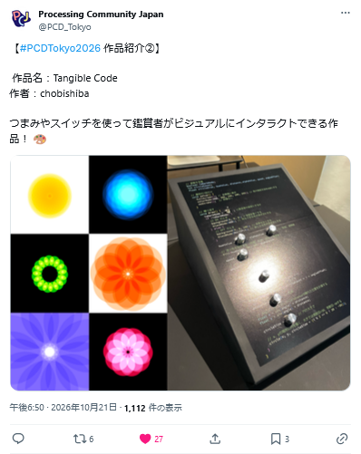
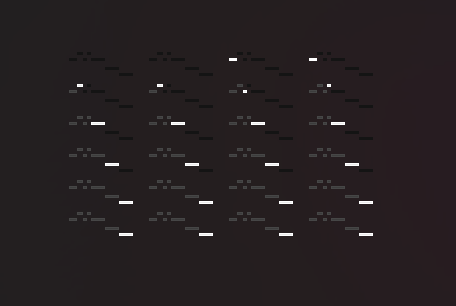
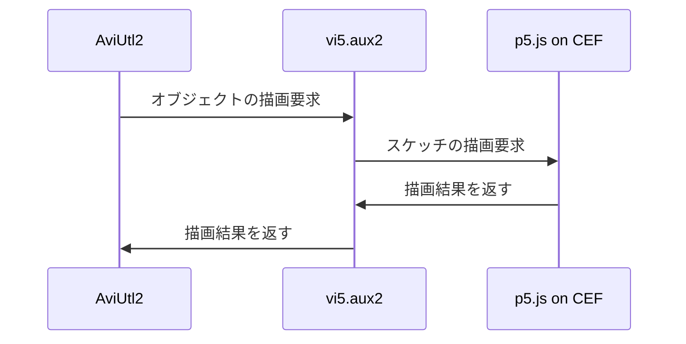

# p5.jsを映像制作ソフトに 埋め込むといいとこ取りが できるのでは？

<!-- Can we embed p5.js into video editing software,   -->
<!-- and get the best of both worlds? -->
<!---->

名無し。（@sevenc_nanashi / sevenc7c.com）

---

# 自己紹介

<v-clicks depth="2">

- 名義：「名無し。」「Nanashi.」
  - 句点/ピリオドを忘れずに！
- 何をやっているか：
  - アプリケーション開発（VOICEVOXなど）
  - 作曲（ボカロP）
  - お絵描き
  - など
- https://sevenc7c.com

</v-clicks>

---

# p5.js / Processingを使う理由

インタラクティブ性を
追加できる

VJ、ゲーム、展示品など...

大量の要素を動かせる

パーティクル、フラクタル的な表現など...

データからビジュアルを作れる

ビジュアライザーなど...

---

# 例：インタラクティブ性

https://twitter.com/PCD_Tokyo/status/2112844060100858326

---

# 例：大量の要素を動かす

<iframe src="https://haukun.github.io/p5js-baton-fireworks/viewer-fireworks/" un-w="auto" un-h="[calc(100%_-_3.5rem)]" un-mx-auto></iframe>

p5.js 花火大会 / https://haukun.github.io/p5js-baton-fireworks/viewer-fireworks/

---

# 例：データからビジュアルを作る

<Youtube id="8T6zb3059P4" un-w="2/3" un-h="2/3" un-mx-auto />

過置換 / 音楽：d.j.ァネイロ / 映像：melonade

文字はp5.jsによる描画、背景はGLSLシェーダーによる描画

---

# 手作業は大変

. / 音楽、映像：xxxx

音楽を変えたら画像を作り直す必要がある  
もしかしたら作り直すのを忘れてしまうかも + タイミングがずれるかも...

---

# 全編p5.jsはしんどい

<v-clicks depth="2">

- 先にあげたような表現は簡単ではある
- それ以外の要素を入れようとすると面倒
  - 文字MV、イラストのアニメーション、などなど...
- 実質的に動画編集ソフトを再発明することになる
  - エコシステムも作らないといけない...
- ブラウザで律速される
  - 重いエフェクト、例えばピクセルソート、モーションブラーなど...
- **既存の動画編集ソフトを使えたほうがいい**
  - WYSIWYGで編集できる

</v-clicks>

---

# p5.jsのスケッチをを映像制作ソフトに 読み込みたい！

---

# 既存の方法

- [p5.jsのスケッチを動画化する方法](https://note.com/outburst/n/n16c9a937d2ea?sub_rt=share_pb) by おかず / Okazz
  - pupetterでブラウザを操作して動画化する方法
- [p5.capture](https://github.com/tapioca24/p5.capture) by tapioca24
  - p5.jsのcanvasを動画や連番画像のZIPとして出力するライブラリ
- [p5-frame-capturer](https://github.com/sevenc-nanashi/p5-frame-capturer)（拙作）
  - File System APIでダイレクトにフォルダ内に連番画像を書き出すライブラリ

「スケッチを素材として読み込む」でしかない！

例えばパラメーターを動画編集ソフトから渡すとかはできない

---

# p5.jsを映像制作ソフトの オブジェクトとして使いたい！

---

# 作った！！（開発中）

---

# vi5.aux2

<v-clicks depth="2">

- AviUtl2プラグイン
- p5.jsのスケッチをオブジェクトとして読み込める
- パラメーターを動画編集ソフトから渡せる
- Powered by Vite
  - TypeScriptはもちろん、既存のプラグインも使える
    - @rollup/plugin-yamlなど

</v-clicks>

<v-clicks depth="2">

- 他のオブジェクトと同じ感覚でp5.jsのスケッチを扱える！
- ネイティブバイナリで動作するのでスケッチ以外は律速されない！

</v-clicks>

---

# 動作デモ

<video src="./assets/vi5_demo.mp4" controls un-w="auto" un-h="full" un-z="20" un-mx-auto></video>

---

# 作品例

<video src="./assets/himawari.mp4" controls un-w="auto" un-h="full" un-z="20" un-mx-auto></video>

ひまわりれしーば / 音楽・映像・イラスト：Nanashi. / ボーカル：春日部つむぎ（VOICEVOX）

---

# vi5.aux2の仕組み

---

# 課題点

<v-clicks depth="1">

- AviUtl2限定
  - （内部的にはAviUtl2以外にも差し替えられるようにはしている）
- 遅い！
  - 固定コストとして30msぐらいかかってくる、60fpsが困難
- 不安定
  - 例えば色々と挙動が怪しい

</v-clicks>

---

# Future Work

<v-clicks depth="1">

- p5.jsをやめる！

</v-clicks>

<v-clicks depth="3">

- [libprocessing](https://github.com/processing/libprocessing)を使う
  - Rustで書かれたProcessingの実装
  - CEFを経由せずテクスチャを取得できる
  - JS以外でもできるかも
    - もしかしたらRubyからでも？
    - HSPからでも？

</v-clicks>

---

# まとめ

<v-clicks depth="1">

- p5.jsはコードでビジュアルを作るのに便利
- 既存の映像制作ソフトはWYSIWYGで編集できるのが便利
- p5.jsを映像制作ソフトに埋め込むといいとこ取りができそう
- プロトタイプとしてvi5.aux2を作った
- まだまだ課題はあるが、libprocessingを使うことで解決できるかも
- ご清聴ありがとうございました！

</v-clicks>

<v-click>

- vi5.aux2：<https://github.com/sevenc-nanashi/vi5.aux2>
- この資料：<https://sevenc7c.com/pcd_tokyo_2026_vi5_aux2>

</v-click>
